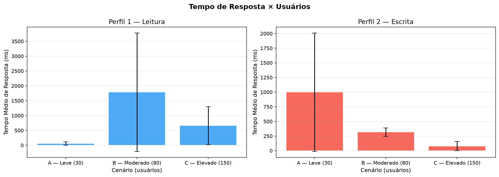
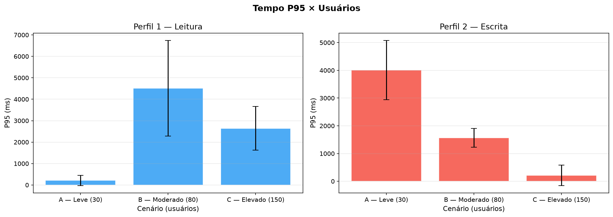
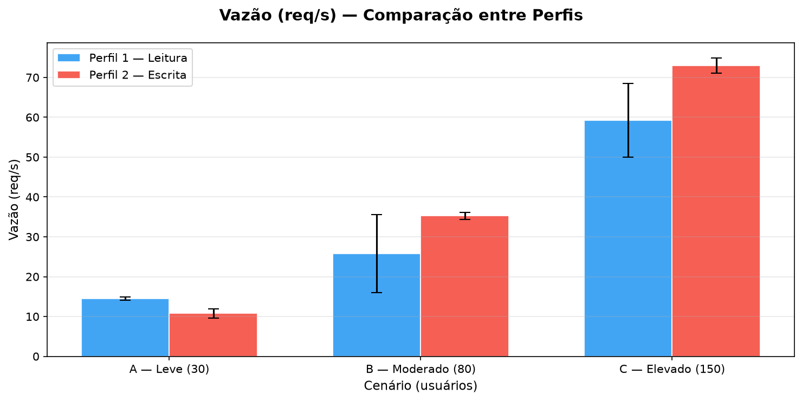
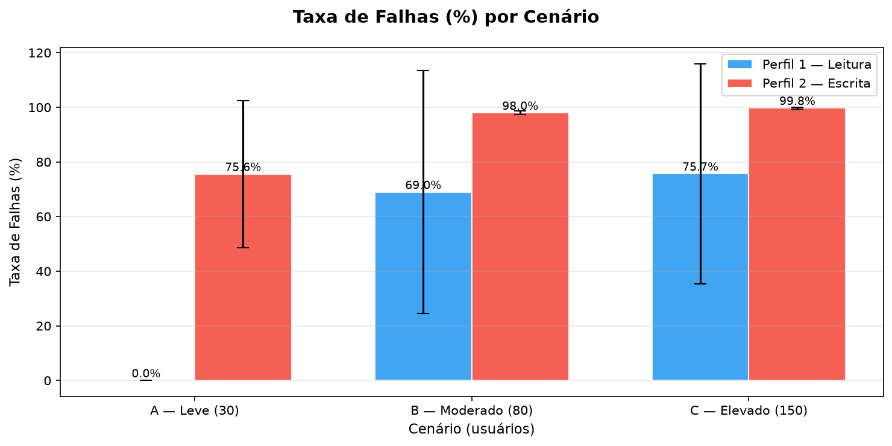
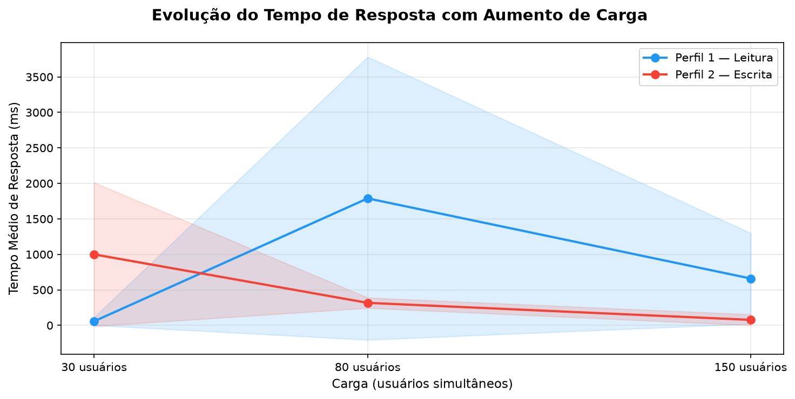
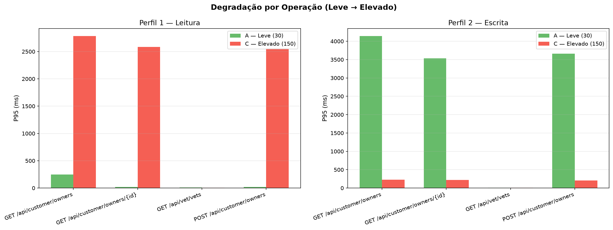
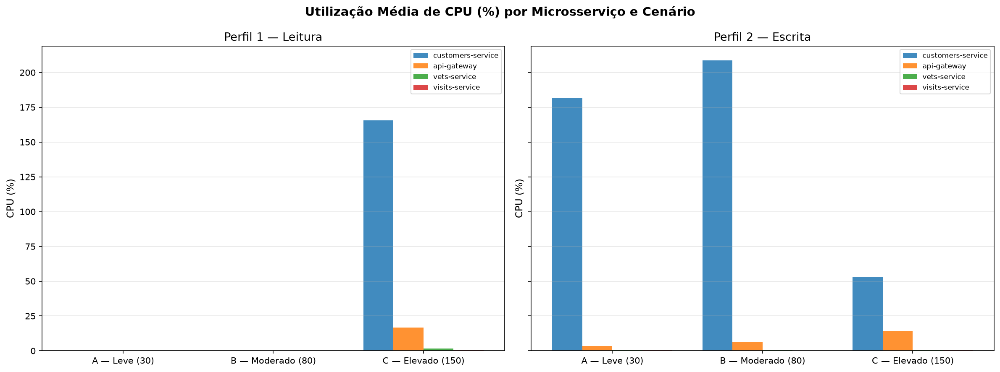

# Trabalho Prático 06 — Avaliação de Desempenho de Microsserviços com Locust

Este repositório contém a implementação, automação e análise de desempenho da aplicação **Spring PetClinic Microservices** submetida a diferentes perfis de carga e intensidades de tráfego utilizando a ferramenta **Locust**.

---

## 📹 Vídeo Demonstrativo
> **Link do Vídeo (YouTube - 4 a 6 minutos):**  
> *[INSERIR O LINK DO VÍDEO AQUI]*  
> *(O vídeo demonstra: inicialização dos containers, execução do Locust em headless e interface web, monitoramento de CPU/memória com docker stats e interpretação dos gráficos/resultados obtidos).*

---

## 💻 Descrição do Ambiente Experimental

Os testes foram executados localmente no seguinte ambiente computacional:

| Componente | Especificação |
|---|---|
| **Sistema Operacional** | Ubuntu 24.04.5 LTS (Noble Numbat) - Kernel Linux 7.0.0-38-generic x86_64 |
| **Processador (CPU)** | 12th Gen Intel(R) Core(TM) i5-1235U (10 núcleos: 2 Performance + 8 Efficient, 12 threads) |
| **Memória RAM** | 16 GB (15 GiB utilizáveis) |
| **Docker Engine** | Versão 29.9.1 (build dfc520d) |
| **Docker Compose** | Versão v5.6.0 |
| **Python** | Versão 3.12.3 |
| **Locust** | Versão 2.47.0 |

---

## 🏗️ Arquitetura da Aplicação e Endpoints

A aplicação avaliada é o [Spring PetClinic Microservices](https://github.com/spring-petclinic/spring-petclinic-microservices), composta pelos seguintes microsserviços principais orquestrados via Docker Compose:
- **api-gateway** (Porta 8080): Ponto único de entrada, roteamento reativo e circuit breakers.
- **customers-service** (Porta 8081): Gerenciamento de proprietários (owners) e animais (pets).
- **vets-service** (Porta 8083): Gerenciamento de veterinários e especialidades.
- **visits-service** (Porta 8082): Gerenciamento de consultas e agendamentos.
- **discovery-server** (Eureka - Porta 8761): Service registry para descoberta dinâmica.
- **config-server** (Porta 8888): Servidor centralizado de configurações.

### Endpoints Avaliados:
Todas as requisições do teste são direcionadas ao **API Gateway** (`http://localhost:8080`), que reescreve os caminhos (`StripPrefix=2`) para os respectivos serviços de domínio:
- `GET /api/customer/owners` $\rightarrow$ Lista todos os proprietários (`customers-service`).
- `GET /api/customer/owners/{id}` $\rightarrow$ Consulta proprietário por ID (`customers-service`).
- `GET /api/vet/vets` $\rightarrow$ Lista os veterinários cadastrados (`vets-service`).
- `POST /api/customer/owners` $\rightarrow$ Cadastra um novo proprietário (`customers-service`).

---

## 🎯 Metodologia Experimental

### 1. Perfis de Carga
Foram implementados dois perfis de comportamento de usuário no [`locustfile.py`](locustfile.py):

| Operação | Perfil 1 — Leitura | Perfil 2 — Escrita |
|---|:---:|:---:|
| `GET /owners` | **45%** | **20%** |
| `GET /owners/{id}` | **35%** | **20%** |
| `GET /vets` | **15%** | **20%** |
| `POST /owners` | **5%** | **40%** |

- **Tempo de espera entre requisições (wait_time):** Intervalo aleatório uniforme entre 1 e 3 segundos (`between(1, 3)`), simulando o comportamento de usuários reais ("think time").

### 2. Cenários de Teste e Repetições
Os dois perfis foram submetidos a três cenários de intensidade de carga:

| Cenário | Usuários Simultâneos | Spawn Rate | Duração Total | Aquecimento (Warm-up) | Medição Efetiva |
|---|:---:|:---:|:---:|:---:|:---:|
| **A — Leve** | 30 | 10 usuários/s | 7 min (420s) | 1 min (60s) | 6 min (360s) |
| **B — Moderado** | 80 | 10 usuários/s | 7 min (420s) | 1 min (60s) | 6 min (360s) |
| **C — Elevado** | 150 | 10 usuários/s | 7 min (420s) | 1 min (60s) | 6 min (360s) |

- **Repetições:** 10 repetições por configuração.
- **Total de Execuções:** 2 perfis $\times$ 3 cenários $\times$ 10 repetições = **60 execuções**.
- **Descarte de Aquecimento:** O primeiro minuto de cada rodada é descartado pelo script de processamento estatístico ([`analyze.py`](analyze.py)), computando-se a média e o desvio padrão exclusivamente da janela estável de 6 minutos.
- **Mecanismo de Checkpoint & Resiliência:** O script de automação ([`run_experiments.sh`](run_experiments.sh)) salva cada resultado individualmente e valida se já existem CSVs concluídos, permitindo pausar e continuar os experimentos sem perda de dados. Durante cada teste, métricas de consumo de CPU e memória são registradas a cada 5 segundos via `docker stats`.

---

## 🚀 Instruções de Reprodução

### Pré-requisitos
- Docker Engine e Docker Compose instalados.
- Python 3.10+ com as dependências instaladas:
  ```bash
  pip install -r requirements.txt
  ```

### 1. Inicializar a Aplicação PetClinic
```bash
# Na pasta do repositório spring-petclinic-microservices:
cd ../spring-petclinic-microservices
docker compose up -d

# Aguarde cerca de 2 a 3 minutos para que todos os serviços se registrem no Eureka:
docker compose ps
```

Verifique se a aplicação está respondendo:
```bash
curl -I http://localhost:8080/api/customer/owners
# Deve retornar HTTP 200 OK
```

### 2. Executar os Experimentos
```bash
# Retorne à pasta do trabalho:
cd ../trabalho06-locust

# Executar a bateria automatizada de testes (com checkpoint e monitoramento de CPU):
chmod +x run_experiments.sh
./run_experiments.sh
```

### 3. Processar Resultados e Gerar Gráficos
Após a conclusão dos testes (ou de parte deles):
```bash
python3 analyze.py
```
Isso gerará os arquivos consolidados em:
- `results/tables/`: Tabelas resumo em CSV (`summary_all.csv`, `raw_all_repetitions.csv`).
- `results/charts/`: Gráficos comparativos de alta resolução em PNG.
- `results/tables/analise_questoes.txt`: Rascunho com o cálculo das respostas para as perguntas.

---

## 📊 Resultados e Análise

*(Esta seção é atualizada automaticamente com a conclusão dos experimentos e a execução do `analyze.py`)*

### Tabela Resumo Consolidada (Média das 10 repetições)

| Perfil | Cenário | Usuários | Tempo Médio (ms) | P95 (ms) | Vazão (req/s) | Total Requisições | Taxa de Falhas (%) |
|---|---|:---:|:---:|:---:|:---:|:---:|:---:|
| *Perfil 1 — Leitura* | A — Leve | 30 | *(em processamento)* | *...* | *...* | *...* | *...* |
| *Perfil 1 — Leitura* | B — Moderado | 80 | *(em processamento)* | *...* | *...* | *...* | *...* |
| *Perfil 1 — Leitura* | C — Elevado | 150 | *(em processamento)* | *...* | *...* | *...* | *...* |
| *Perfil 2 — Escrita* | A — Leve | 30 | *(em processamento)* | *...* | *...* | *...* | *...* |
| *Perfil 2 — Escrita* | B — Moderado | 80 | *(em processamento)* | *...* | *...* | *...* | *...* |
| *Perfil 2 — Escrita* | C — Elevado | 150 | *(em processamento)* | *...* | *...* | *...* | *...* |

### Gráficos Comparativos

1. **Tempo de Resposta Médio por Usuários:**  
   

2. **Percentil 95 (P95) por Usuários:**  
   

3. **Comparativo de Vazão (Throughput):**  
   

4. **Taxa de Falhas por Cenário:**  
   

5. **Curva de Degradação do Tempo de Resposta:**  
   

6. **Degradação por Operação / Endpoint:**  
   

7. **Consumo de CPU dos Microsserviços:**  
   

---

## ❓ Respostas às Questões de Análise

### 1. Como o aumento de usuários afeta o tempo de resposta?
> *Resposta a ser consolidada com os dados finais de medição após o término das baterias.*

### 2. Qual perfil apresenta maior vazão?
> *Resposta a ser consolidada com os dados finais de medição após o término das baterias.*

### 3. Quais operações apresentam maior degradação?
> *Resposta a ser consolidada com os dados finais de medição após o término das baterias.*

### 4. Como o consumo de CPU varia entre os cenários?
> *Resposta a ser consolidada com os dados finais de medição após o término das baterias.*

### 5. Qual cenário apresenta maior taxa de falhas?
> *Resposta a ser consolidada com os dados finais de medição após o término das baterias.*

---

## 🏁 Conclusões
*(Síntese das observações arquiteturais sobre gargalos de E/S, capacidade do API Gateway vs. Customers Service e recomendações de escalabilidade horizontal).*

---

## 📁 Estrutura do Repositório

```
trabalho06-locust/
├── locustfile.py           # Definição dos perfis de carga e tarefas do Locust
├── run_experiments.sh     # Script de automação das 60 baterias com checkpoint
├── analyze.py             # Script de tratamento estatístico e geração de gráficos
├── requirements.txt       # Dependências Python (Locust, Pandas, Matplotlib, Numpy)
├── README.md              # Documentação completa, instruções e análise
└── results/
    ├── csv/               # Histórico e sumários de todas as 60 execuções do Locust e CPU
    ├── tables/            # Tabelas consolidadas em formato CSV e texto
    └── charts/            # Gráficos de desempenho gerados em PNG
```
